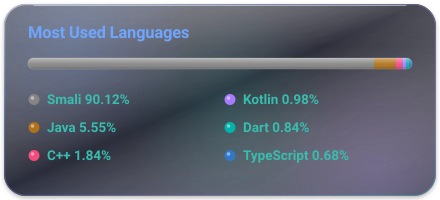
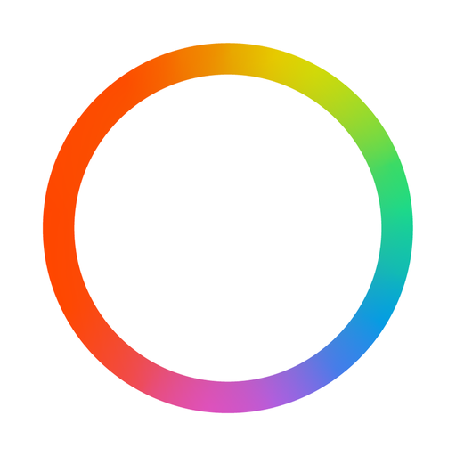
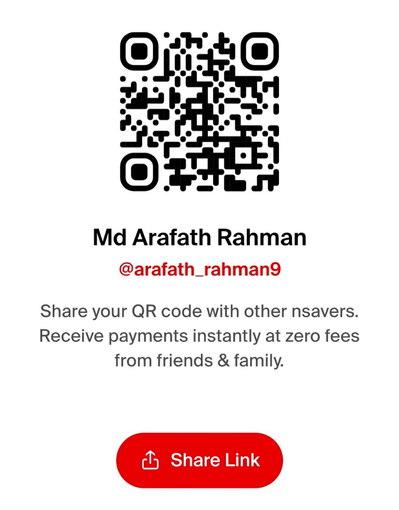
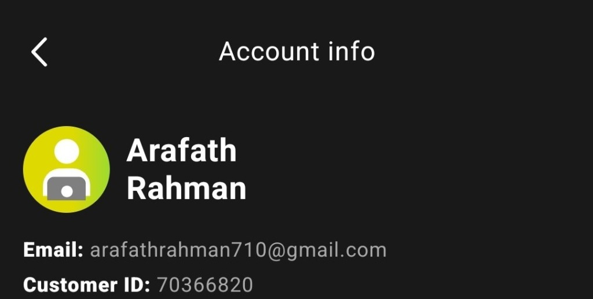

# Md Arafath Rahman

 

<a href="https://www.facebook.com/arafath.rahman.57956" target="_blank"><picture><source media="(prefers-color-scheme: dark)" srcset="assets/readme/dark/badge-facebook.svg"><source media="(prefers-color-scheme: light)" srcset="assets/readme/light/badge-facebook.svg"></picture></a> <a href="https://reddit.com/user/anonymousvigilantex" target="_blank"><picture><source media="(prefers-color-scheme: dark)" srcset="assets/readme/dark/badge-reddit.svg"><source media="(prefers-color-scheme: light)" srcset="assets/readme/light/badge-reddit.svg"></picture></a> <a href="mailto:arafathrahman711@gmail.com"><picture><source media="(prefers-color-scheme: dark)" srcset="assets/readme/dark/badge-email.svg"><source media="(prefers-color-scheme: light)" srcset="assets/readme/light/badge-email.svg"></picture></a> <a href="https://github.com/smartworldarafath"><picture><source media="(prefers-color-scheme: dark)" srcset="assets/readme/dark/badge-profile-views.svg"><source media="(prefers-color-scheme: light)" srcset="assets/readme/light/badge-profile-views.svg"></picture></a>

  

<a href="https://smartworldarafath.github.io/smartworldarafath/" target="_blank"><picture><source media="(prefers-color-scheme: dark)" srcset="assets/readme/dark/badge-interactive.svg"><source media="(prefers-color-scheme: light)" srcset="assets/readme/light/badge-interactive.svg"></picture></a>

---

Android and software developer focused on native performance, Material 3 Expressive UI, and modern web applications. Active open-source contributor across upstream projects.

- **Building:** High-end native Android apps (Kotlin, Jetpack Compose) and modern web ecosystems.
- **Design:** Minimalist UI, Material Design 3 Expressive, Liquid Glass and fluid physics-based motion.
- **Open Source:** Bug fixes, performance optimizations, and [Reverse Engineering Wi-Fi Router](https://github.com/smartworldarafath/Reverse-Engineer-WiFi-Router) (AI-powered router privacy audit & diagnostic toolkit).

> *If it's not smooth, it's not finished. Obsessed with eliminating lag and perfecting motion.*

---

### Tech Stack & Tooling

**Languages & Core Systems**  

  <picture>
    <source media="(prefers-color-scheme: dark)" srcset="assets/readme/dark/pill-kotlin.svg">
    <source media="(prefers-color-scheme: light)" srcset="assets/readme/light/pill-kotlin.svg">
    
  </picture>
  <picture>
    <source media="(prefers-color-scheme: dark)" srcset="assets/readme/dark/pill-java.svg">
    <source media="(prefers-color-scheme: light)" srcset="assets/readme/light/pill-java.svg">
    
  </picture>
  <picture>
    <source media="(prefers-color-scheme: dark)" srcset="assets/readme/dark/pill-ts.svg">
    <source media="(prefers-color-scheme: light)" srcset="assets/readme/light/pill-ts.svg">
    
  </picture>
  <picture>
    <source media="(prefers-color-scheme: dark)" srcset="assets/readme/dark/pill-js.svg">
    <source media="(prefers-color-scheme: light)" srcset="assets/readme/light/pill-js.svg">
    
  </picture>
  <picture>
    <source media="(prefers-color-scheme: dark)" srcset="assets/readme/dark/pill-python.svg">
    <source media="(prefers-color-scheme: light)" srcset="assets/readme/light/pill-python.svg">
    
  </picture>
  <picture>
    <source media="(prefers-color-scheme: dark)" srcset="assets/readme/dark/pill-c.svg">
    <source media="(prefers-color-scheme: light)" srcset="assets/readme/light/pill-c.svg">
    
  </picture>
  <picture>
    <source media="(prefers-color-scheme: dark)" srcset="assets/readme/dark/pill-dotnet.svg">
    <source media="(prefers-color-scheme: light)" srcset="assets/readme/light/pill-dotnet.svg">
    
  </picture>

**Platforms, Cloud & Infrastructure**  

  <picture>
    <source media="(prefers-color-scheme: dark)" srcset="assets/readme/dark/pill-android.svg">
    <source media="(prefers-color-scheme: light)" srcset="assets/readme/light/pill-android.svg">
    
  </picture>
  <picture>
    <source media="(prefers-color-scheme: dark)" srcset="assets/readme/dark/pill-compose.svg">
    <source media="(prefers-color-scheme: light)" srcset="assets/readme/light/pill-compose.svg">
    
  </picture>
  <picture>
    <source media="(prefers-color-scheme: dark)" srcset="assets/readme/dark/pill-gcp.svg">
    <source media="(prefers-color-scheme: light)" srcset="assets/readme/light/pill-gcp.svg">
    
  </picture>
  <picture>
    <source media="(prefers-color-scheme: dark)" srcset="assets/readme/dark/pill-firebase.svg">
    <source media="(prefers-color-scheme: light)" srcset="assets/readme/light/pill-firebase.svg">
    
  </picture>
  <picture>
    <source media="(prefers-color-scheme: dark)" srcset="assets/readme/dark/pill-linux.svg">
    <source media="(prefers-color-scheme: light)" srcset="assets/readme/light/pill-linux.svg">
    
  </picture>
  <picture>
    <source media="(prefers-color-scheme: dark)" srcset="assets/readme/dark/pill-git.svg">
    <source media="(prefers-color-scheme: light)" srcset="assets/readme/light/pill-git.svg">
    
  </picture>
  <picture>
    <source media="(prefers-color-scheme: dark)" srcset="assets/readme/dark/pill-figma.svg">
    <source media="(prefers-color-scheme: light)" srcset="assets/readme/light/pill-figma.svg">
    
  </picture>

---

### Engineering Metrics & Stats

<picture>
  <source media="(prefers-color-scheme: dark)" srcset="assets/readme/dark/stats-github.svg">
  <source media="(prefers-color-scheme: light)" srcset="assets/readme/light/stats-github.svg">
  
</picture>
<picture>
  <source media="(prefers-color-scheme: dark)" srcset="assets/readme/dark/stats-streak.svg">
  <source media="(prefers-color-scheme: light)" srcset="assets/readme/light/stats-streak.svg">
  
</picture>

  

<picture>
  <source media="(prefers-color-scheme: dark)" srcset="assets/readme/dark/stats-langs.svg">
  <source media="(prefers-color-scheme: light)" srcset="assets/readme/light/stats-langs.svg">
  
</picture>

---

## Support / Sponsor

If you find my open-source work helpful and wish to support ongoing engineering, maintenance, and tooling development:

<a href="https://www.supportkori.com/arafathrahman" target="_blank">
  <picture>
    <source media="(prefers-color-scheme: dark)" srcset="assets/readme/dark/support-table.svg">
    <source media="(prefers-color-scheme: light)" srcset="assets/readme/light/support-table.svg">
    
  </picture>
</a>
<!-- | ** nsave** | Ntag: `@arafath_rahman9` (Md Arafath Rahman) | -->
<!-- | ** RedotPay** | Account ID: `1965421414` | -->
<!-- | ** Payoneer** | Email: `arafathrahman710@gmail.com` (Customer ID: 70366820) | -->

 

<a href="https://www.supportkori.com/arafathrahman" target="_blank">
  <picture>
    <source media="(prefers-color-scheme: dark)" srcset="assets/readme/dark/badge-supportkori.svg">
    <source media="(prefers-color-scheme: light)" srcset="assets/readme/light/badge-supportkori.svg">
    
  </picture>
</a>

---

<a href="SUPPORT.md" target="_blank">
  <picture>
    <source media="(prefers-color-scheme: dark)" srcset="assets/readme/dark/badge-bmc.svg">
    <source media="(prefers-color-scheme: light)" srcset="assets/readme/light/badge-bmc.svg">
    
  </picture>
</a>
 
<b>▲ Tap the button for the full support page &mdash; or expand payment options &amp; QR codes below</b>

  <b>Show all payment options &amp; QR codes</b>

 

<table>
  <tr>
    <td align="center" width="25%" valign="top">
      <h4> SupportKori</h4>
       
      Cards / bKash / Nagad <a href="https://www.supportkori.com/arafathrahman">supportkori.com/arafathrahman</a>
    </td>
    <td align="center" width="25%" valign="top">
      <h4> nsave</h4>
       
      Ntag: <code>@arafath_rahman9</code>
    </td>
    <td align="center" width="25%" valign="top">
      <h4> RedotPay</h4>
       
      Account ID: <code>1965421414</code>
    </td>
    <td align="center" width="25%" valign="top">
      <h4> Payoneer</h4>
       
      <code>arafathrahman710@gmail.com</code> Customer ID: <code>70366820</code>
    </td>
  </tr>
</table>

 

**Outside Bangladesh?** Cards, Apple Pay &amp; Google Pay:

<a href="https://www.buymeacoffee.com/arafathrahman" target="_blank">
  <picture>
    <source media="(prefers-color-scheme: dark)" srcset="assets/readme/dark/badge-bmc-online.svg">
    <source media="(prefers-color-scheme: light)" srcset="assets/readme/light/badge-bmc-online.svg">
    
  </picture>
</a>

