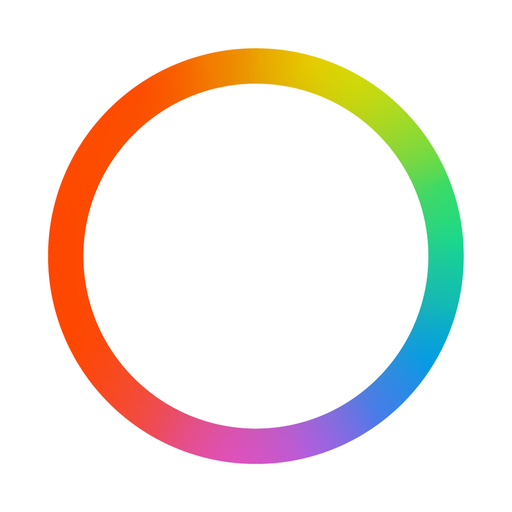
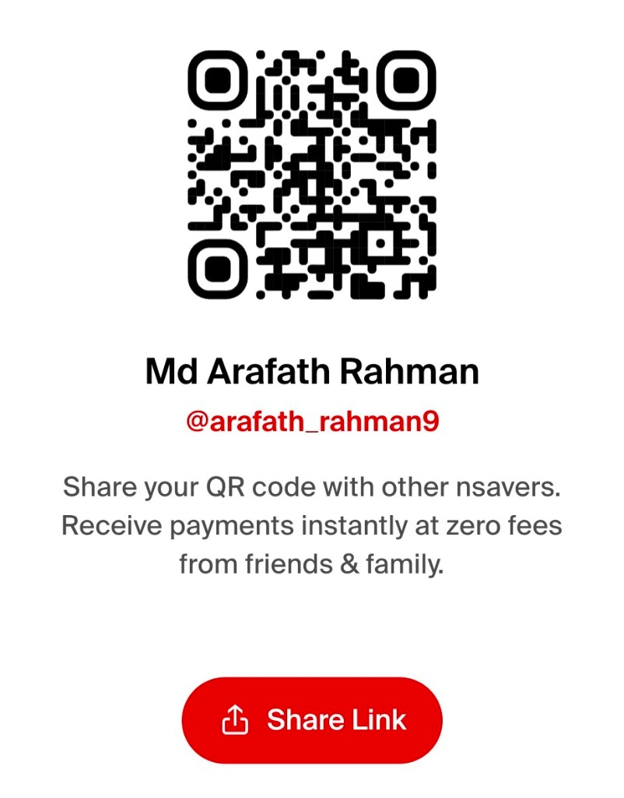
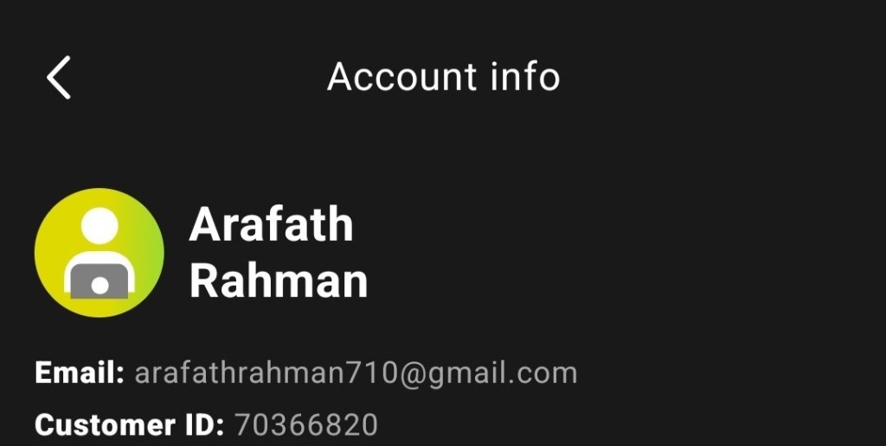

# Md Arafath Rahman

 

---

### Overview

Software engineer specializing in high-performance Android systems architecture, high-refresh-rate display optimization (120Hz/144Hz), and fluid UI engineering. Passionate about eliminating frame drops, minimizing runtime overhead, and constructing deterministic, resilient developer tooling. Active open-source contributor across upstream ecosystems, including VS Code, Qwen, and modern web environments.

### Core Focus & Capabilities

- **Systems & Android:** Native Android architecture (Kotlin, Java), Jetpack Compose, high-refresh-rate display synchronization, frame pacing, and binary analysis / reverse engineering.
- **Architecture & Web:** Modern reactive systems, TypeScript, clean architecture patterns, resilient API design, and modular codebases.
- **UI Engineering:** Material Design 3 Expressive, physics-driven fluid motion, minimalist ergonomics, and cross-platform consistency.
- **Engineering Principle:** Performance is not an afterthought. If an interaction drops frames or stutters under load, it is not production-ready.

---

### Tech Stack & Tooling

**Languages & Core Systems**  

**Platforms, Cloud & Infrastructure**  

---

### Engineering Metrics & Stats

  

---

## Support / Sponsor

If you find my open-source work helpful and wish to support ongoing engineering, maintenance, and tooling development:

| Method | Details / Direct Link |
| :--- | :--- |
| ** SupportKori** | [https://www.supportkori.com/arafathrahman](https://www.supportkori.com/arafathrahman) |
| ** nsave** | Ntag: `@arafath_rahman9` (Md Arafath Rahman) |
| ** RedotPay** | Account ID: `1965421414` |
| ** Payoneer** | Email: `arafathrahman710@gmail.com` (Customer ID: 70366820) |

 

---

 
<b>▲ Tap the button for the full support page &mdash; or expand payment options &amp; QR codes below</b>

  <b>Show all payment options &amp; QR codes</b>

 

<table>
  <tr>
    <td align="center" width="25%" valign="top">
      <h4> SupportKori</h4>
       
      Cards / bKash / Nagad <a href="https://www.supportkori.com/arafathrahman">supportkori.com/arafathrahman</a>
    </td>
    <td align="center" width="25%" valign="top">
      <h4> nsave</h4>
       
      Ntag: <code>@arafath_rahman9</code>
    </td>
    <td align="center" width="25%" valign="top">
      <h4> RedotPay</h4>
       
      Account ID: <code>1965421414</code>
    </td>
    <td align="center" width="25%" valign="top">
      <h4> Payoneer</h4>
       
      <code>arafathrahman710@gmail.com</code> Customer ID: <code>70366820</code>
    </td>
  </tr>
</table>

 

**Outside Bangladesh?** Cards, Apple Pay &amp; Google Pay:

